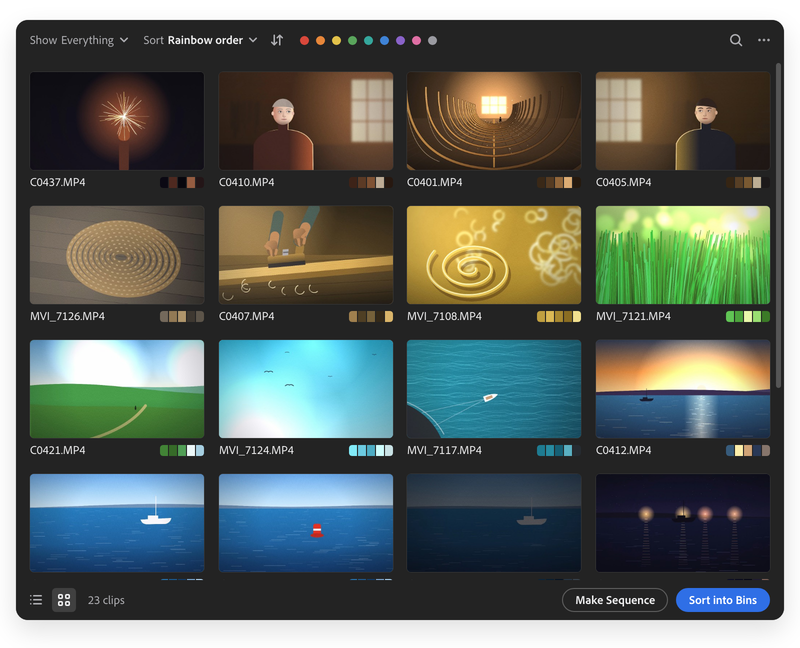
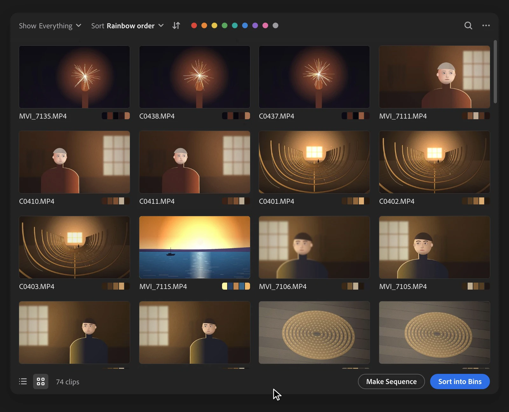

# Select

A Premiere Pro panel that sorts and searches your clips in seconds. Everything runs on your Mac.

  

Press **Scan**. Select reads every clip: the picture, the sound and the camera's details. **Show** picks which clips you see, **Sort** puts them in order, and search finds what is in them.

Select is in beta. Try it on a copy of a project first.

## Install

- macOS 13 or later. Apple silicon; Intel is untested.
- Premiere Pro 2023 (version 23) or later. Tested on 26.5.
- MP4 and MOV. MXF needs [ffmpeg](https://ffmpeg.org).
- Not on Windows.

### Steps

Get **Select.pkg** from the [latest release](https://github.com/skyfallstatus/select/releases/latest).

1. Open `Select.pkg`. macOS says it can't be opened. Click **Done**.
2. Go to **System Settings › Privacy & Security**, scroll down, and click **Open Anyway** next to Select.
3. Follow the installer. Select installs for you only, so it doesn't ask for an administrator's password.
4. Restart Premiere, then choose **Window › Extensions › Select**.

On macOS 13 or 14, you can instead Control-click the package and choose **Open**.

### Updates

Select updates itself. When a new version is ready, a line at the top of the panel says so. **Restart** switches to it, or Premiere uses it the next time it opens. Only versions signed with Select's own key are accepted. The package isn't signed by Apple, which is why macOS asks once.

To remove Select, quit Premiere and delete `com.skyfallstatus.select` from `~/Library/Application Support/Adobe/CEP/extensions`, and the folders `~/Library/Application Support/com.skyfallstatus.select` and `~/Library/Caches/com.skyfallstatus.select`.

## Use

1. Select clips or bins in the Project panel, or nothing for the whole project, and press **Scan**. The line under the toolbar says what it will read. **Scan a Folder…** in the **···** menu scans a folder on disk.
2. **Show**, a colour dot and search narrow what's on screen, and **Sort** puts it in order. In the grid, hover a picture for a second, then move across it to scrub through the clip. Right-click a clip for a menu.
3. **Make Sequence** and **Sort into Bins** write to the project: the clips you selected in Select, or every clip on screen. **Label** is in the right-click menu. **Undo**, right after or later in the **···** menu, takes it back.

  

Results come back when the panel opens again on the same project. Another project needs its own scan.

## More

- What it looks at, and how often it was right on real footage: [docs/WHAT-IT-LOOKS-AT.md](docs/WHAT-IT-LOOKS-AT.md).
- What it writes to a project, how its Undo works, and what stays on your Mac: [docs/WHAT-IT-WRITES.md](docs/WHAT-IT-WRITES.md).
- Testing it, and what to send back: [BETA.md](BETA.md). Building it: [CONTRIBUTING.md](CONTRIBUTING.md).

Once a day Select asks GitHub whether there is a new version. That is the only thing it sends. **Check Automatically** in the **···** menu turns it off.

## License

MIT. See [LICENSE](LICENSE) and [NOTICE](NOTICE).
