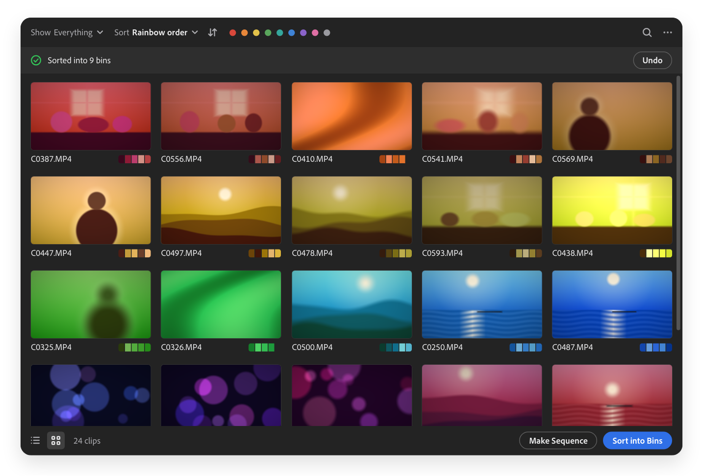
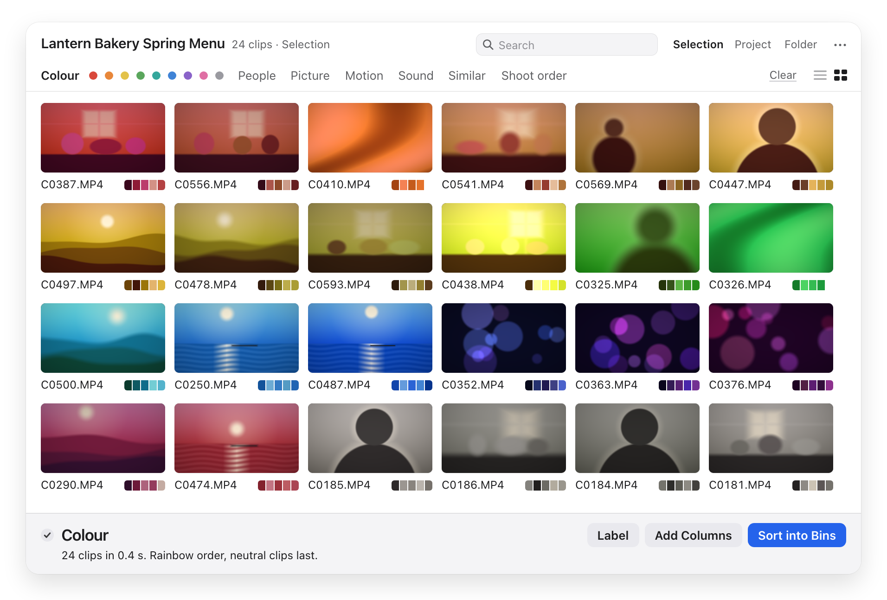

# Select

A Premiere Pro panel that sorts hundreds of clips in seconds, so you know where to look first.

<p align="center">
  
</p>

Press **Scan** and Select looks at every clip: the picture, the sound and the camera's details. Then pick what to **Show** (interviews, people, speech, similar shots…) and how to **Sort** (sharpness, brightness, colour, length…). Search finds what's in your clips. Everything stays on your Mac.

<p align="center">
  <picture>
    <source media="(prefers-color-scheme: dark)" srcset="docs/media/panel-grid-dark.png">
    
  </picture>
</p>

Select is in beta. Sorting changes nothing, but try the buttons that write to your project on a copy first.

## Install

### Requirements

- **macOS** 13 Ventura or later
- **Mac** with Apple silicon, or Intel (untested so far)
- **Premiere Pro** 2023 (version 23) or later
- **Footage:** MP4 and MOV. MXF needs [ffmpeg](https://ffmpeg.org).
- **Windows** isn't supported.

So far it has been tested on Premiere 26.5 with an Apple silicon Mac.

### Steps

Get **Select.pkg** from the [latest release](https://github.com/skyfallstatus/select/releases/latest).

1. Open `Select.pkg`. macOS says it can't be opened. Click **Done**.
2. Go to **System Settings › Privacy & Security**, scroll down, and click **Open Anyway** next to Select.
3. Follow the installer.
4. Restart Premiere, then choose **Window › Extensions › Select**.

On macOS 13 or 14, you can instead Control-click the package and choose **Open**.

## Use

1. Choose **Selection**, **Project** or **Folder** at the top, and press **Scan**.
2. Pick from **Show** and **Sort**, tap a colour dot, or search.
3. Happy with the view? **Label**, **Add Columns** or **Sort into Bins** puts it in your project. **Undo** takes it back.

Your media files are never changed. What each option measures, and how accurate it is, is in [What Select looks at](docs/WHAT-IT-LOOKS-AT.md).

## Privacy

Nothing leaves your Mac: no account, no tracking, no network. Results are kept in `~/Library/Caches/com.skyfallstatus.select`.

## Feedback

Bugs, odd formats and ideas are welcome. Use **Report a Bug** in the panel's **···** menu, or see [BETA.md](BETA.md) for what's most useful to hear.

To remove Select, quit Premiere and delete `com.skyfallstatus.select` from `/Library/Application Support/Adobe/CEP/extensions`.

<details>
<summary>Building from source</summary>

You need the Command Line Tools with Swift, so you don't need Xcode. It's been built with Swift 6.3. There are no dependencies. ffmpeg and Node are only used by the tests, and they're skipped with a clear message if they're missing.

```sh
scripts/build-engine.sh     # the engine, for Apple silicon and Intel
scripts/build-panel.sh      # the panel with the engine inside, in dist/
scripts/test.sh             # the tests. No footage or Premiere needed
scripts/dev-install.sh      # copies it to your own extensions folder
```

`dev-install.sh` installs an unsigned copy, which needs Adobe's debug mode. It tells you how. Testers don't need any of this.

```
engine/Sources    the native engine: file reader, decoding, scores, cache
engine/tests      the contract test and the fuzz test
panel/            the panel: CSXS manifest, client, host script, tests
scripts/          build, sign, package, release, privacy scan
docs/             the engine's interface, formats, packaging, releasing
product.conf      the name, ids and version, in one place
```

See [CONTRIBUTING.md](CONTRIBUTING.md).

</details>

## License

MIT. See [LICENSE](LICENSE).
