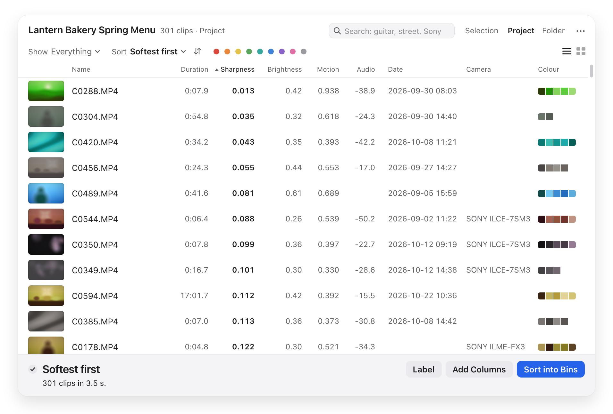
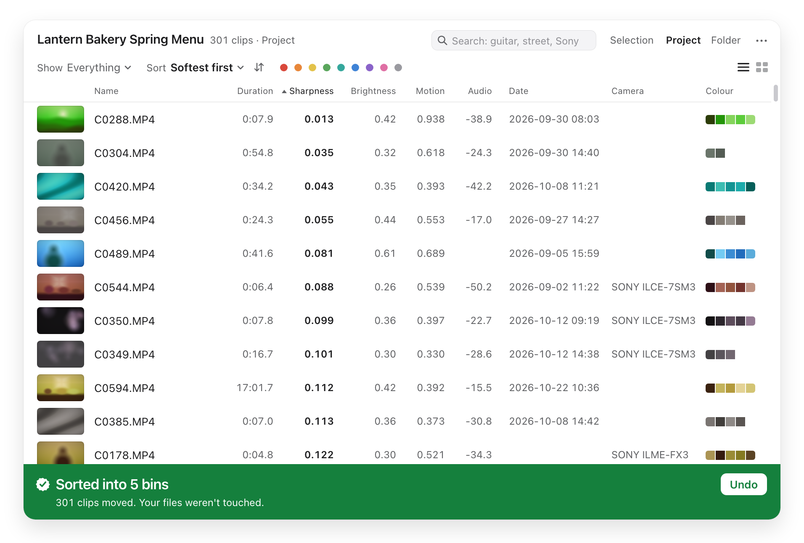

# Select

A Premiere Pro panel that ranks hundreds of clips in seconds, so you know where to look first.

<p align="center">
  
</p>

Select lives in a panel inside Premiere. Choose your clips, press **Scan**, and every clip gets looked at: three moments for picture, a few short stretches for sound, and the file's own details. Then two menus do the rest. **Show** picks which clips: interviews, people, no people, mediums, wides, speech, music, silent, text on screen or similar shots. **Sort** puts them in order: by shoot time, length, sharpness, brightness, highlights, motion, camera shake, loudness, colour or name. The two work together, so *Interviews, longest first* or *People, softest first* is two clicks. A colour dot narrows it again, and search finds what's in the clips.

Everything happens on your Mac. No clip, frame or word leaves it.

<p align="center">
  <picture>
    <source media="(prefers-color-scheme: dark)" srcset="docs/media/panel-grid-dark.png">
    
  </picture>
</p>

Sorting changes nothing. Your project only changes when you press a button that says so, and your files never change at all.

<p align="center">
  <picture>
    <source media="(prefers-color-scheme: dark)" srcset="docs/media/panel-dark.png">
    
  </picture>
</p>

Select is in beta, so please try the buttons that write to your project on a copy of it first.

## Download

Get **Select.pkg** from the [latest release](https://github.com/skyfallstatus/select/releases/latest).

You'll need a Mac with macOS 13 or later, and Premiere Pro 23 or later. So far it has only been run on Premiere 26.5, on macOS 27 with an M5 Max. Older versions of both are untested, and it's built for Intel too, but it has never run on an Intel Mac. If you're on one of those, please try it and tell us how it goes. Windows isn't supported.

## Installing

Select isn't signed by Apple yet, so macOS asks you to confirm the first time. It takes a minute, and you only do it once per version.

1. Open `Select.pkg`. macOS says it can't be opened. Click **Done**.
2. Go to **System Settings › Privacy & Security** and scroll down to **Security**.
3. Next to the message about Select, click **Open Anyway**, enter your password, then click **Open**.
4. Follow the installer. It asks for your password again, because the folder it uses is shared by everyone on the Mac.
5. Quit Premiere if it's open, then open it again. Select is under **Window › Extensions**.

On macOS 13 or 14 you can skip the first three steps: Control-click the package and choose **Open**.

You don't need the Terminal, and you don't need to turn on Adobe's debug mode.

To remove Select, quit Premiere and delete the `com.skyfallstatus.select` folder from `/Library/Application Support/Adobe/CEP/extensions`. macOS asks for your password. Select also remembers its results in `~/Library/Caches/com.skyfallstatus.select`, including thumbnails, file paths and any camera location, so delete that folder too.

## Show and Sort

All of these are places to look first. None of them is a verdict on a clip.

**Show** picks which clips are on screen.

- **Interviews.** Speech heard and a face seen, 15 seconds or longer, and steady where the camera recorded that. Shorter clips with someone talking were nearly always not interviews. On a real event shoot it found 20 clips, and 19 were interviews. It finds likely interviews, not certain ones.
- **People, No people.** Whether Select saw anyone in three moments of the clip. It misses people in the dark and undercounts crowds. On 60 real clips it was right about whether anyone was there on 57.
- **Mediums, Wides.** From the size of the head or body in the frame, on tall frames as well as wide ones: medium is someone from about the waist up, or closer; wide is people small in the frame. A statue can get a face. On 30 real clips with someone in them it agreed with a person's call on 27. Nearly all of those clips were tall frames, so wide frames are less tested.
- **Speech, Music, Silent.** From six seconds of sound sampled across the clip, so a word or a song elsewhere in it can be missed. Crowd noise can read as speech. Silent is clips with no audio track, or silence wherever it was sampled. We've checked sound less than the rest.
- **Text on screen.** Words on signs and titles. It found about half of what was readable, mostly big clear lettering, and about two words in five are misreads. It's good for finding the shot of the sign.
- **Similar shots.** Groups clips that show the same setup, such as repeated takes, among the clips in one folder, and keeps each group together. On 973 real clips it made 45 groups. Of 33 we checked, 31 were true repeats, and the two misses were flat textures. The same place from another angle usually stays apart.

**Sort** puts them in order. Each starts the useful way round, and the arrows beside it turn it round.

- **Shoot order.** By the time written in the file, then by name. It trusts the camera's clock.
- **Duration, Loudness.** Longest first, loudest first. Loudness is the average level of the sampled sound.
- **Sharpness.** Sharpest first, or softest first turned round. Good at finding soft clips. It doesn't rank in-focus clips against each other, so the top isn't "your best shot". It reads one frame per clip, so a clip that's soft for a moment can slip past, and a plain wall scores low because it has no fine detail.
- **Brightness.** The average brightness of that one frame. Log footage and night scenes sit low on purpose.
- **Highlights.** How much of that one frame hits the top of the range. It can do little on log footage, because log rarely clips. A window or a lamp can account for all of it.
- **Motion.** A stand-in, not real motion tracking. It reads how much the compressed frame sizes change along the clip, without looking at a single frame. It's weak on all-intra footage, where every frame is stored whole, and busy detail or a change of light can read as motion.
- **Camera shake.** Steadiest first, from the camera's own gyro, on the Sony clips that record one. Other clips stay blank at the end. It's measured over about a second and a half of the clip.
- **Colour.** Clips in rainbow order by their main colour, with neutral clips last. It reads log footage through its own curve, so S-Log has real colours here. On 60 real clips it matched what a person would say on 57. The colour dots show one colour at a time.

**Sort into Bins** follows what's on screen: a bin per colour when sorted by colour, a bin per day in shoot order, a bin per group of similar shots, one bin for a Show such as Interviews, and five bins from top to bottom for the other sorts.

<p align="center">
  
</p>

## Good to know

- **Your files are never changed.** The bins and columns write to the project, never to your files.
- **Use Undo in the panel, not Cmd+Z.** Premiere only keeps its last 50 steps, so Cmd+Z can't take back a big **Label**, **Add Columns** or **Sort into Bins**. **Undo** in the panel checks that each clip really went back and tells you if one didn't. It remembers your last write until the panel is reloaded.
- **It's quick, and how quick depends on your Mac.** On an M5 Max from a USB SSD, 973 clips, 510 GB, got their file details and scores in about 5 seconds, which is about 2 seconds per 400, and the full look at people, words, sound and colour finished after 14 seconds. The list is usable from the start. A rescan took under a tenth of a second, because results are remembered. Yours will vary.
- **Labels and words are suggestions.** They come from Apple's on-device models, and they're often right and sometimes odd. On 60 real clips the top labels were fair on 47 of 57, and the misses were mostly art taken literally.
- **Camera and lens depend on sidecar files.** Select reads them from the small file some cameras write beside each clip, such as Sony's `M01.XML`. Move a clip without it and those columns go blank.
- **A blank score means Select couldn't get it, never a guess.** Blank clips sort last. When a clip's picture can't be read, Select says why. If your Mac has no decoder for a clip, the file details stay and the picture scores stay blank. See [Formats](#formats).

## Formats

MP4 and MOV work on their own. MXF works when [ffmpeg](https://ffmpeg.org) is installed, and it's much slower, because each clip goes through ffmpeg: the full look took 0.3 to 2 seconds per MXF clip on the same M5 Max, against about 0.15 seconds for an MP4. RED and BRAW aren't supported yet.

Select uses your Mac's own video decoders, and not every Mac has one for every format. H.264 10-bit 4:2:2, which is what Sony's XAVC S-I modes record, is the one to watch: on the Mac tested, macOS only decodes it with hardware. A Mac without that hardware leaves the picture scores blank, unless ffmpeg is installed, which fills them in more slowly. The file details and sound work either way.

To install ffmpeg, get [Homebrew](https://brew.sh) and run `brew install ffmpeg`. Select finds it by itself.

The full picture, and how sure we are of each part, is in [docs/FORMATS.md](docs/FORMATS.md).

## Privacy

The panel sends nothing. There's no account, no tracking and no check for updates, so a new version is something you download yourself.

Labels, faces, words and sounds are all worked out on your Mac, with models that come with macOS. We scanned with the network blocked and every result came out the same, and the engine opened no network connection during a scan.

**Report a Bug** only opens a GitHub page in your browser. Nothing is sent unless you type it in and press submit. Please leave out file names, paths and client names.

Results, thumbnails and the fingerprints used to compare shots stay on your Mac, in `~/Library/Caches/com.skyfallstatus.select`. It's kept under 2 GB, about 50,000 clips, by dropping the clips used longest ago. Select writes nothing beside your media.

## Contributing

Bug reports, odd formats and ideas are all welcome. See [CONTRIBUTING.md](CONTRIBUTING.md).

<details>
<summary>Building from source</summary>

You need the Command Line Tools with Swift, so you don't need Xcode. It's been built with Swift 6.3. There are no dependencies. ffmpeg and Node are only used by the tests, and they're skipped with a clear message if they're missing.

```sh
scripts/build-engine.sh     # the engine, for Apple silicon and Intel
scripts/build-panel.sh      # the panel with the engine inside, in dist/
scripts/test.sh             # the tests. No footage or Premiere needed
scripts/dev-install.sh      # copies it to your own extensions folder
```

`dev-install.sh` installs an unsigned copy, which needs Adobe's debug mode. It tells you how. Testers don't need any of this.

```
engine/Sources    the native engine: file reader, decoding, scores, cache
engine/tests      the contract test and the fuzz test
panel/            the panel: CSXS manifest, client, host script, tests
scripts/          build, sign, package, release, privacy scan
docs/             the engine's interface, formats, packaging, releasing
product.conf      the name, ids and version, in one place
```

</details>

## License

MIT. See [LICENSE](LICENSE). Credits are in [NOTICE](NOTICE).
